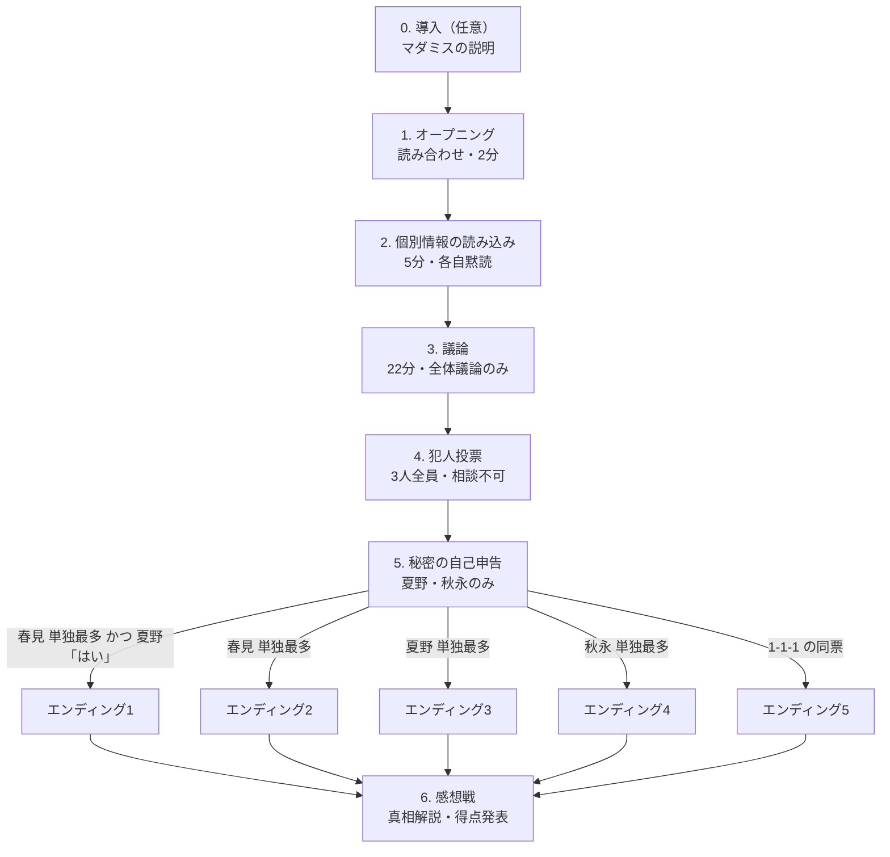

# ゲームの進行

3 人用・GM 不要・約 35 分。全体議論 1 回と投票 1 回で決着する、最小構成のマーダーミステリー。

## 進行の流れ

| # | 段階 | 時間の目安 | 内容 | 資料 |
|---|---|---|---|---|
| 0 | 導入（任意） | 1分〜 | マダミスの基本とマナーの説明。経験者だけなら省略 | [台本0](02_script/0_introduction.md) |
| 1 | オープニング | 2分 | 全員で読み合わせ。地の文=春見、スタッフ（NPC）=秋永、台詞=各キャラ担当 | [台本1](02_script/1_opening.md) |
| 2 | 個別情報の読み込み | 5分 | 各自が自分の個別情報を黙読する。早く読み終われば短縮してよい | [03_characters/](03_characters/) |
| 3 | 議論 | 22分 | 3 人で全体議論。密談なし。議論はこの 1 回だけで、終了後は相談できない | [共通情報](04_public-info.md#共通情報議論の開始時に公開) |
| 4 | 犯人投票 | 1分 | 全員が 1 票。相談不可。自分に投票してもよい | [投票の仕様](05_votes-scoring-endings.md#投票) |
| 5 | 秘密の自己申告 | 1分 | 夏野・秋永が「議論中に自分の秘密を指摘されたか」を はい/いいえ で申告 | [投票の仕様](05_votes-scoring-endings.md#投票) |
| 6 | エンディング | 3分 | 投票結果に対応する 1 本を読み合わせ。地の文はエンディングごとに指定 | [台本2](02_script/2_endings.md) |
| 7 | 感想戦 | 自由 | 真相解説・全員の個別情報・全エンディングを公開し、得点を発表 | [06_debrief.md](06_debrief.md) |

## 情報の公開タイミング

| タイミング | 公開する情報 | 対象 |
|---|---|---|
| 開始時 | あらすじ／登場人物（公開プロフィール） | 全員 |
| 1 の後 | オープニングの本文（読み返し用） | 全員 |
| 2 の開始時 | 個別情報 | **各キャラ本人のみ** |
| 3 の開始時 | 共通情報（持ち物・現場の情報・スタッフ証言・見取り図） | 全員 |
| 6 の後 | 全エンディング・全員の個別情報・真相解説 | 全員 |

## BGM

| 区間 | 曲 | 長さ |
|---|---|---|
| 導入〜オープニング | bgm_02 | 1:05 |
| 個別情報の読み込み | bgm_03 | 1:43 |
| 議論 | bgm_04 | 2:04 |
| 投票・自己申告 | bgm_03 | 1:43 |
| エンディング | bgm_01 | 2:39 |
| 感想戦 | bgm_05 | 3:14 |

いずれもループ再生。出典は DOVA-SYNDROME／zukisuzuki BGM／GARETOCO（作者コメントより）。
