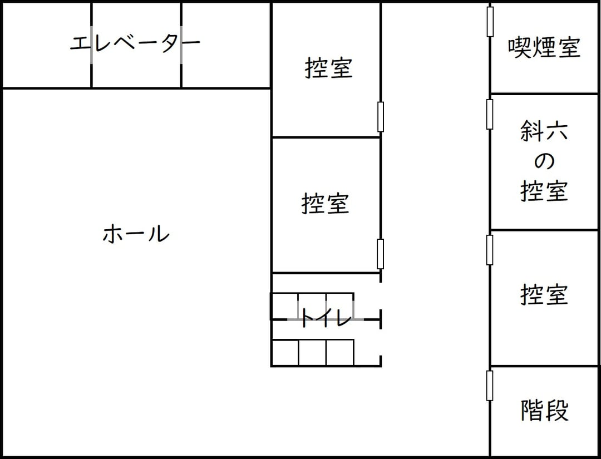

# 公開情報

全員が見られる情報。配布タイミングは [01_game-flow.md](01_game-flow.md#情報の公開タイミング)。

## あらすじ（最初から公開）

　ファンサービスはおろか、メディア露出も一切しないが、類まれなる推理力でその名を轟かせた“伝説の探偵”――斜六(しゃろく)。2年前に探偵業から退いた彼が、ある未解決事件への考察を元にした探偵小説を書き上げたという。“伝説の探偵”が初めて描く探偵小説ということで世間は沸いた。  
　しかし、そのお披露目イベントの会場控室で、斜六は死体となって発見される。偶然重なった清掃による階段封鎖とエレベーターの故障により、斜六の死体発見前後に控室と同じ階にいた者は少ない。そのうち、単独で行動していたのは３名だけであった。  
　すなわち、この中に斜六を殺害した犯人がいる――。  

## 登場人物（最初から公開）

### 春見（はるみ）

30代男性  
一人称：俺  
赤毛  

### 夏野（なつの）

40代男性  
一人称：私  
黒髪  

### 秋永（あきなが）

20代男性  
一人称：僕  
茶髪  

## 共通情報（議論の開始時に公開）

#### ◆持ち物

**春見のトートバッグ**  
財布・スマートフォン・電子タバコが入っている。  

**夏野のハンドバッグ**  
財布・スマートフォン・「“伝説の探偵”斜六が書き上げた初の探偵小説」という帯がついた小説が入っている。  

**秋永のショルダーバッグ**  
財布・スマートフォン・ライターが入っている。  

#### ◆情報

- 被害者は〈斜六の控室〉で胸から血を流して亡くなっている。
- 他の〈控室〉に怪しいところはない。
- 男性トイレの一番奥の個室に**血の付いた上着**と**ナイフ**が捨てられていた。
- 〈喫煙室〉で、破壊された**盗聴器**が見つかった。
- スタッフは全員〈トイレ〉〈喫煙室〉を使用していない。

#### ◆証言

<u>掃除をしていたスタッフ</u>  
11:10～11:20に〈喫煙室〉の掃除をしましたが、怪しいものはありませんでした。  
11:20頃、〈トイレ〉に入っていく**秋永さん**を見かけましたよ。  

<u>設備点検をしていたスタッフ</u>  
11:30～11:40に〈斜六の控室〉〈喫煙室〉に入った方はいませんでした。  
11:40～11:50に**春見さん**が〈喫煙室〉にいるのを見ました。  

<u>斜六を控室へ案内したスタッフ</u>  
11:50頃、**夏野さん**が〈トイレ〉にいるのを見かけましたね。  

#### ◆間取り図

