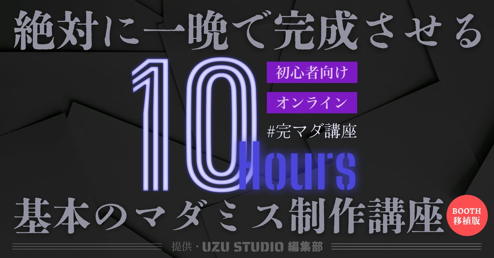
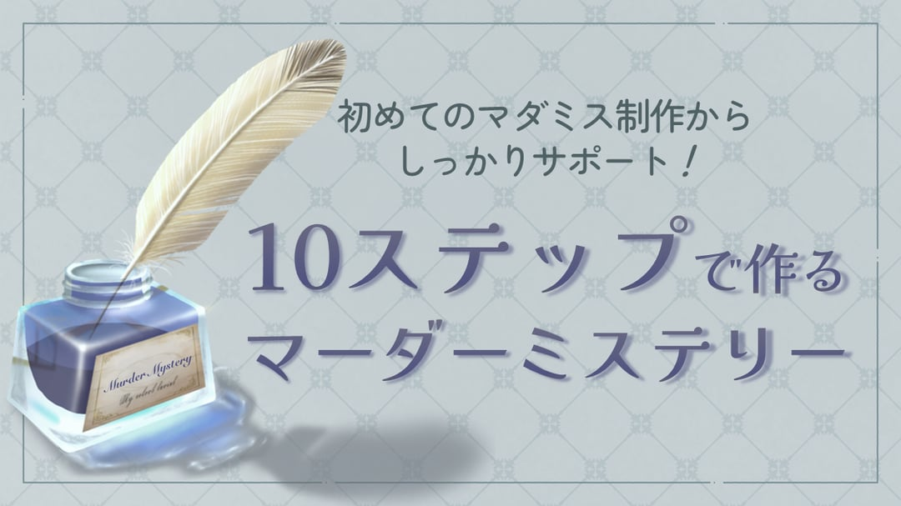

# 感想戦・真相解説・あとがき

ゲーム終了後に公開する資料。あわせて全員の個別情報と全エンディングも公開する。

## 感想戦とは？

隠していたこと、考えていたことなどを明かして、シナリオの振り返りをする時間です。必須ではありませんので、この後に予定がある場合は互いに挨拶をして解散しましょう。  

#### ◆楽しい感想戦のススメ

　気の知れた仲なら大丈夫かもしれませんが、お互いのプレイングを否定するような発言はオススメしません。  
　陣営ごとに勝ち負けのようなものがあるゲームとは言え、大切なのは勝敗ではなく、物語の登場人物としての会話や駆け引きを楽しむことです。「君のせいで負けた」「ちゃんと言ってくれないから分からなかった」のような責める発言をするのではなく、「犯人/探偵役が上手かった」「どこまで話していいか難しいよね」など、褒めたり共感したりする内容に置き換えるのがオススメです。  

#### ◆キャラクターについて

　マダミスでは、それぞれのキャラクターが別々の情報や秘密を持っています。自分が演じたキャラクターがどのような人物で、どのような秘密を持っていたのか、お互いに話してみるとよいでしょう。  

#### ◆推理について

　マダミスは推理小説とは違い、犯人や隠したいことのある人が議論に参加して、自分のしたことをごまかそうとするため、じっくり見れば犯人と分かる情報があったとしても「そう言うなら犯人じゃないかも？」と相手の嘘に惑わされることもあるでしょう。  
　お互いにどういう考えでどんな発言をしていたのか、どういうときにヒヤヒヤしたのかなどを共有すると盛り上がるかもしれません。  

#### ◆エンディングについて

　「キャラクターの結果」にある「テキスト」からは全パターンのエンディングが確認できます。別の投票結果となっていたらどんなエンディングだったのか見てみるのも楽しいでしょう。

## 真相解説

#### ◆STEP1

　亡くなっているのは白髪の男性。まずは**彼が何時まで生きていたのか**を追っていく。  

> <u>11:10～11:20</u>  
> 黒髪の男性(夏野)と白髪の男性がホールで話している  
>   
> <u>11:40～11:50</u>  
> トイレの個室で斜六が電話をする声を聞いた  

　以上の2点が出てくるだろう。事件発覚はオープニングおよび個別情報より、12:00と分かるので、11:50～12:00が犯行時刻と思われる。  
　では、その時間帯の行動を整理しよう。  

> **春見**：ホールでエレベーターを待っている。  
> **夏野**：トイレで小説を拾う。  
> **秋永**：ホールへ向かい、赤毛の男性(春見)がいるのを見ている。  

　春見がホールにいたことは秋永も見ているので確実だ。また、秋永がそれを証明できるということは秋永もホールへ行った証明になる。さらに、夏野がトイレにいたことはスタッフからも証言が出ている。  
　となると、11:50～12:00に犯行ができた者はいない。つまり、犯人はいない……でよいかというとそんなわけがない。実はまだ大きな勘違いが残っているのだ。  

#### ◆STEP2

　11:40～11:50、**トイレで秋永が聞いた斜六の声は本当に白髪の男性のものなのか**。該当箇所を読み返すと、秋永はあくまで「昔聞いた斜六の声」と認識しているだけであり、その声＝白髪の男性の声とは認識していない。  
　また、逆に白髪の男性について、春見・秋永は「斜六と名乗った」、「握手に応じる様子からして斜六らしい」といった認識をしているだけである。春見視点では、白髪の男性が本物の斜六だとしたら、ボディガードをしていた妹のことを全く知らないのは不自然とも見えるかもしれない。  

　もし、白髪の男性が斜六を名乗る偽物で、本物の斜六が別にいるとしたら……。  
　11:40からの電話の声は本物の斜六ということになり、**被害者である白髪の男性の目撃情報は11:10～11:20が最後**ということになる。  

#### ◆STEP3

　11:30～11:40は誰も〈斜六の控室〉に入っていないという証言が出ているので除くとして、先程確認しなかった11:20～11:30、11:40～11:50の行動を見ていこう。  

> <u>11:20～11:30</u>  
> **春見**：？  
> **夏野**：喫煙室にいる  
> **秋永**：トイレにいる  

　秋永がトイレにいることはスタッフの証言から確実である。  
　夏野は喫煙室にいたことを言わないかもしれないが、11:10～11:20の清掃時には喫煙室になかった盗聴器を11:40に春見が見ていることが共有されていれば、夏野が喫煙室に行っていることが透けてくるだろう。  

> <u>11:40～11:50</u>  
> **春見**：喫煙室にいる  
> **夏野**：トイレにいる  
> **秋永**：トイレで斜六の電話の声を聞いている  

　春見が喫煙室にいることはスタッフの証言から確実である。また、秋永がトイレにいた点も、電話の声を聞いているのが重要証言として機能するため信憑性は高くなるだろう。  
　夏野はトイレにいたことを言わないかもしれないが、夏野の隠し事である「**実は斜六自身である**」ことが明らかとなっていれば、秋永の証言から、夏野がトイレにいたことは証明できる。  

　となると浮いてくるのは、**春見の11:20～11:30の行動**だ。実際には「？＝斜六の控室にいる」であるが、皆さんの回の春見は何と言っただろうか。  
　結論としては、「**春見が犯人であり、11:20～11:30が犯行時刻**」である。  
　春見のごまかしが上手であれば逃げ切っていただろうし、ごかましきれていなかったら時系列整理から犯人である可能性は高まったことだろう。  
　ちなみに犯人には殺害後、トイレに凶器を捨てに行く時間がなければならないが、春見にはその時間もきちんとある（11:30～11:40）。  

#### ◆裏設定

　白髪の男性が斜六の名を騙った理由は、夏野(本物の斜六)がキャラクターテキスト内で考察している通りです。作家として鳴かず飛ばずの自分に嫌気がさして魔がさして、姿が知られていない・引退している斜六の名を使うことで、自身の探偵小説を売り出そうとしたのでした。  

#### ◆その他

　エンディング1または2に辿り着くと、タイトルの本当の意味が描写されます。『“伝説の探偵”殺人事件』は「“伝説の探偵”が殺された事件」ではなく、「“伝説の探偵”殺人事件を見事解決」という見出しの一部だったのです。  

　本物の斜六の声を知っている秋永が、なぜ夏野をすぐに斜六だと見抜けなかったのか。それは夏野の個別情報に書いてあります。夏野は春見・秋永の前では、普段と声色を変えて喋っていたのでした。

## ネタバレガイドライン

マダミスは、真相はもちろんのこと、キャラクターの詳細やストーリー展開といった中身を知らない状態から、話し合い・駆け引き・展開を楽しむものです。あなたがプレイ前に知らなかったことは全てネタバレです。  
　これから遊ぶ人の楽しみを損なわないよう、ネタバレを含む感想投稿には十分注意しましょう。  

<u>NG例1：秋永役でした。推理難しかった。</u>  
「キャラクター名」＋「推理が～」と書くと、そのキャラクターが犯人ではなく、探偵陣営側であることが透けてしまいます。  

<u>NG例2：夏野役。もう少し時間があれば！</u>  
「キャラクター名」＋「時間が足りなかった」のような内容からも、そのキャラクターが犯人ではなさそうなことが分かってしまいます。  

<u>NG例3：犯人当てられなかった～</u>  
犯人がおらず「自殺」や「事故」が結論となるシナリオも存在するため、「犯人がいる」という情報もネタバレになることがあります。  

<u>NG例4：斜六がまさか偽物だったとは</u>  
推理のキーとなる気付きであり、プレイ前には知らなかった情報のはずです。  

<u>NG例5：エンディングがエモくて感動した</u>  
今回のシナリオには該当しませんが、「感動的」だと事前に明かされていないシナリオでエンディングの傾向について言及するとネタバレになることがあります。  

---

　迷ったときは、とりあえず「楽しかった！」「一緒に遊んでくれた人ありがとう！」と書いておけば大丈夫です。

## あとがき

本シナリオは、2023年11月に中野のエンタメビルにて開催された『完成するまで帰れないマダミス完成講座ー月跨ぎの10時間編ー』に向けた実験のため、また実際に10時間以内で作ったシナリオの例として遊んでもらうために制作されました。  

#### ◆実際の制作時間配分

- プロット：1時間半
- 個別情報：2時間半
- 間取り図：15分
- 共通情報：15分
- ゲームの流れの設定：15分
- 分岐の設定：15分
- オープニング：30分
- エンディング：1時間
- 真相解説：30分
- 微調整：30分
- ウズの動作確認：15分

#### ◆10時間に含まれない部分

- サムネイル作り：30分
- BGM選び：30分
- テストプレイ2回：2時間
- テストプレイ後の微調整：1時間

---

上記の講座と同内容を場所・時間問わず実践できる「絶対に一晩で完成させる基本のマダミス制作講座」を販売中（ウズスタジオ編集部 作成）↓  
[https://uzuapp.booth.pm/items/5340737](https://uzuapp.booth.pm/items/5340737)  

---

一晩ではなく、仕事や学校終わりに、じっくりコツコツ進めたい方向け「10ステップで作るマーダーミステリー」も販売中（アラン校長 個人作成）↓  
[https://school-enigma.booth.pm/items/7186279](https://school-enigma.booth.pm/items/7186279)  

